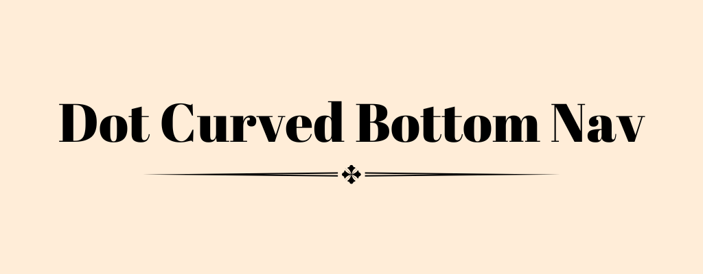
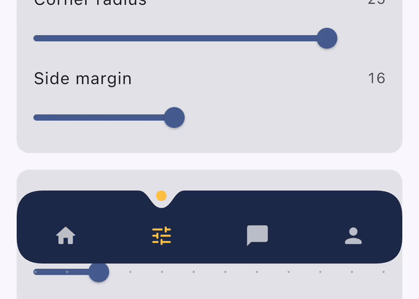
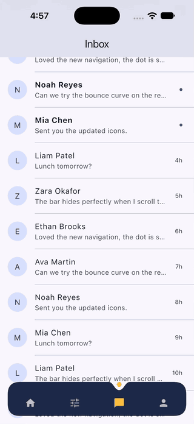

# Dot Curved Bottom Nav

[](https://pub.dev/packages/dot_curved_bottom_nav "dot_curved_bottom_nav")

An animated bottom navigation bar whose top edge curves around a dot that marks the selected item.



## Features

- The dot glides between items and the curve follows it.
- Optional hide on scroll: the bar slides away while scrolling down and comes back when scrolling up.
- Items shrink slightly while pressed and spring back when released.
- Colors, height, dot size, corner radius, margin, animation duration and curve are all configurable.
- Works in right-to-left layouts and stays clear of the device's bottom safe area.
- Moving the dot only repaints the bar, so the animation stays cheap.

## Getting started

Add the package to your `pubspec.yaml`:

```yaml
dependencies:
  dot_curved_bottom_nav: ^0.1.0
```

Then import it:

```dart
import 'package:dot_curved_bottom_nav/dot_curved_bottom_nav.dart';
```

## Usage

Keep the selected index in your state and update it from `onTap`. Setting `extendBody: true` on the `Scaffold` lets page content show around the floating bar.

```dart
class HomeScreen extends StatefulWidget {
  const HomeScreen({super.key});

  @override
  State<HomeScreen> createState() => _HomeScreenState();
}

class _HomeScreenState extends State<HomeScreen> {
  int _currentIndex = 0;

  static const _icons = [
    Icons.home_rounded,
    Icons.search_rounded,
    Icons.favorite_rounded,
    Icons.person_rounded,
  ];

  @override
  Widget build(BuildContext context) {
    return Scaffold(
      extendBody: true,
      body: Center(child: Text('Page $_currentIndex')),
      bottomNavigationBar: DotCurvedBottomNav(
        selectedIndex: _currentIndex,
        onTap: (index) => setState(() => _currentIndex = index),
        backgroundColor: const Color(0xFF1E2A4A),
        indicatorColor: const Color(0xFFFFC145),
        height: 70,
        items: [
          for (var i = 0; i < _icons.length; i++)
            Icon(
              _icons[i],
              color: i == _currentIndex
                  ? const Color(0xFFFFC145)
                  : Colors.white70,
            ),
        ],
      ),
    );
  }
}
```

Changing `selectedIndex` from your own code, for example after a swipe in a `PageView`, moves the dot too. `onTap` is only called when the user taps an item.

## Hide on scroll



Give the bar the `ScrollController` of the page's scroll view and turn on `hideOnScroll`:

```dart
final _scrollController = ScrollController();

// In build:
Scaffold(
  extendBody: true,
  body: ListView.builder(
    controller: _scrollController,
    itemBuilder: (context, index) => ListTile(title: Text('Item $index')),
  ),
  bottomNavigationBar: DotCurvedBottomNav(
    scrollController: _scrollController,
    hideOnScroll: true,
    selectedIndex: _currentIndex,
    onTap: (index) => setState(() => _currentIndex = index),
    items: const [Icon(Icons.home), Icon(Icons.person)],
  ),
);
```

The same controller can be shared by several scroll views, for example one per tab. Turning `hideOnScroll` off brings a hidden bar back.

## Properties

| Property | Default | Description |
| --- | --- | --- |
| `items` | required | The widgets shown in the bar, usually icons. Use two to five. |
| `selectedIndex` | `0` | The index of the selected item. |
| `onTap` | `null` | Called with an item's index when the user taps it. |
| `backgroundColor` | `Colors.black` | The color of the bar. |
| `indicatorColor` | `Colors.white` | The color of the dot. |
| `height` | `75` | The height of the bar, not counting `margin`. At most 75. |
| `indicatorSize` | `5` | The radius of the dot. Its diameter plus 4 must fit in half of `height`. |
| `borderRadius` | `25` | The corner radius of the bar, from 0 to 30. |
| `margin` | 16 horizontal, 20 vertical | The space around the bar. The bottom margin is never smaller than the bottom safe area. |
| `animationDuration` | 600 ms | How long the dot takes to move, and how long the bar takes to hide or show. |
| `animationCurve` | `Curves.easeOut` | The curve the dot follows when it moves between items. |
| `pressedScale` | `0.85` | How small an item shrinks while pressed. Use `1` to turn the effect off. |
| `scrollController` | `null` | The controller of the page's scroll view. Required when `hideOnScroll` is on. |
| `hideOnScroll` | `false` | Whether the bar hides while the user scrolls down. |

### Sizing

Each item is at least 40 pixels wide, and the notch around the first and last item has to fit between the rounded corners. Five items with the default dot need a bar at least 204 pixels wide, which any phone has with the default margin. In debug builds, a bar that's too narrow reports how wide it needs to be.

## Example

The [example app](https://github.com/Muzammil-Bit/dot_curved_bottom_nav/tree/master/example) has several tabs and a Style tab for trying every option live.

## Roadmap

- More indicator shapes, such as a diamond with a matching cut-out.

## Contributions

Feel free to open an issue if you find a bug or need a feature. Pull requests are welcome.

If you want to connect with me on LinkedIn: [Muzammil Hussain](https://www.linkedin.com/in/muzammil-developer/ "Muzammil Hussain")

If you like this work, please consider liking the package and starring the repo. It is appreciated.
